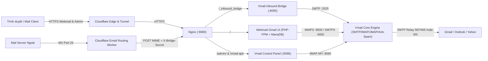

# Vmail — Open, Lightweight & Automated Mail Server

**Vmail** là hệ thống Mail Server mã nguồn mở **miễn phí trọn đời (không cần bản quyền)**, thiết kế gọn nhẹ, hiệu năng cao, giao diện **Webmail chuẩn Gmail (tự động làm mới & thông báo tức thì)**, **Admin Console trực quan**, tích hợp sẵn **Transactional Mail API**, **Email Marketing an toàn**, và **tự động hóa 1-click Cloudflare** (DNS + Tunnel + Inbound Email Routing Worker).

---

## ✨ Tính năng nổi bật

- **Hoàn toàn miễn phí & Độc lập (Zero License):** Mở toàn bộ tính năng quản trị tên miền, hộp thư, alias, quota, chống spam, relay và API không giới hạn. Chế độ chạy kín nội bộ an toàn.
- **Giao diện Webmail chuẩn Gmail:** Roundcube tối ưu sâu (`skins/gmail`) với bố cục Gmail quen thuộc, dark/light logo, **tự động làm mới ngầm mỗi 5 giây**, chuông thông báo, toast nổi góc trái dưới, Web Notification OS, âm thanh báo thư mới và favicon/tiêu đề đếm thư chưa đọc `(N) Vmail`.
- **Webmail & Admin đa tên miền tự động:** Mọi tên miền thêm vào hệ thống đều tự động có địa chỉ truy cập riêng dạng `https://mail.<ten-mien>/` và `https://mail.<ten-mien>/admin/`, thông minh tự nối `@<ten-mien>` khi đăng nhập.
- **Tự động hóa Cloudflare 1-Click:**
  - Tự động quét toàn bộ Zone Cloudflare và đồng bộ tên miền vào Mail Server.
  - Tự tạo & cập nhật bản ghi **DKIM** (Ed25519 + RSA), **SPF**, **DMARC**, **Webmail CNAME** & **Cloudflare Tunnel Ingress**.
  - Nhận thư vượt NAT / IP nhà mạng bị chặn port 25 thông qua **Cloudflare Email Routing + Cloudflare Worker -> Vmail Inbound Bridge** với header sạch chuẩn `Received: ... (Vmail SMTP)`.
- **Gửi thư chuẩn Inbox — Không bị Spam:**
  - Hỗ trợ **SMTP Relay** (Brevo, Resend, SendGrid, Gmail, SES...) và theo dõi thực tế `250 OK` từ log MTA thay vì báo thành công ảo.
  - Công cụ **Check DNS** kiểm tra trực tiếp 5/5 bản ghi thực tế từ Internet.
- **Transactional Mail API & Email Marketing:**
  - Endpoint `POST /vmail-api/v1/send` cấp OTP/đơn hàng tốc độ cao, giới hạn quota/ngày, IP/CIDR allowlist, chống CRLF header injection.
  - Quản lý danh bạ CSV, mẫu HTML (`{{name}}`, `{{email}}`, `{{webmail_url}}`), giãn nhịp warmup bảo vệ uy tín gửi, pixel theo dõi mở và One-Click Unsubscribe chuẩn RFC 8058.
- **An toàn & Bảo mật mặc định:**
  - Ký HMAC-SHA256 session cookie (`HttpOnly; SameSite=Lax; Secure`), rate-limit chống brute-force đăng nhập, strict CSP, `X-Frame-Options`, `X-Content-Type-Options: nosniff`, mã hóa mật khẩu gửi thư tại chỗ bằng `secret.key` (`0600`).

---

## 🏗️ Kiến trúc hệ thống



---

## 💻 Tương thích đa hệ điều hành & Phần cứng

`install.sh` tự động nhận diện hệ điều hành, trình quản lý gói, thư viện C (`glibc`/`musl`), init system (`systemd`/`OpenRC`/standalone), SELinux/Firewall và tự khắc phục xung đột cổng hoặc database:

| Hệ điều hành | Phiên bản hỗ trợ | Gói & Init System | Cổng Web & DB |
|---|---|---|---|
| **Ubuntu / Debian** | Ubuntu 20.04–24.04+, Debian 11/12/13, Armbian | `apt`, `systemd` / PRoot | MariaDB hoặc SQLite |
| **RHEL / Rocky / Alma / CentOS / Fedora / Amazon Linux** | EL8 / EL9 / Fedora / AL2023 | `dnf` / `yum`, `systemd`, auto SELinux + `firewalld` | MariaDB hoặc SQLite |
| **Alpine Linux** | Alpine 3.18 – 3.21+ | `apk`, `musl` binary, `OpenRC` | MariaDB hoặc SQLite |
| **Arch Linux / Manjaro** | Rolling | `pacman`, `systemd` | MariaDB hoặc SQLite |

- **Kiến trúc CPU hỗ trợ:** `x86_64` (`amd64`), `aarch64` (`arm64`), `armv7l` (`armhf`) — cả bản `gnu` lẫn `musl`.
- **Tài nguyên tối thiểu:** 1 vCPU, 512 MB–1 GB RAM (~220–240 MB RAM toàn bộ stack).
- **Cơ chế tự khắc phục (Self-Healing):**
  - Tự hoàn tất Bootstrap Mode trên server trắng, cấp phát listener tách cổng (`8090` thay `8080`) để không đụng Nginx.
  - Tự động chuyển sang **SQLite** cho Webmail nếu VPS ít RAM/container không chạy được MariaDB.
  - Tự phát hiện socket PHP-FPM (`unix:` hoặc `127.0.0.1:9000`), quyền user web (`www-data`/`nginx`/`apache`/`http`), SELinux boolean và firewalld.
  - Tự kiểm tra sức khỏe toàn bộ endpoint & sinh xác minh ngay sau khi cài đặt (`vmail doctor`).

---

## 🚀 Cài đặt nhanh (1 Lệnh)

### Cách 1: Cài đặt tương tác (Interactive)

```bash
git clone https://github.com/dsnbw/vmail.git
cd vmail
sudo bash install.sh
```

### Cách 2: Cài đặt tự động hoàn toàn qua tham số (Kèm Cloudflare & SMTP Relay)

```bash
git clone https://github.com/dsnbw/vmail.git
cd vmail
sudo bash install.sh \
  --domain example.com \
  --admin-email admin@example.com \
  --admin-pass 'StrongPass@2026!' \
  --cf-email you@example.com \
  --cf-key 'YOUR_CLOUDFLARE_GLOBAL_API_KEY' \
  --relay-host smtp-relay.brevo.com \
  --relay-port 587 \
  --relay-user 'your_smtp_login' \
  --relay-pass 'your_smtp_key' \
  --http-port 8080 \
  --non-interactive
```

Sau khi cài đặt hoàn tất:
- **Webmail (Giao diện Gmail):** `https://mail.<ten-mien>/`
- **Vmail Admin Console:** `https://mail.<ten-mien>/admin/`
- **Transactional Send API:** `POST https://mail.<ten-mien>/vmail-api/v1/send`

---

## 🧰 Quản trị nhanh qua CLI (`vmail`)

```bash
vmail status                       # Kiểm tra RAM, Disk, tiến trình, cổng dịch vụ & thống kê
vmail doctor                       # Tự chẩn đoán toàn bộ tiến trình, cổng & tệp cấu hình
vmail start | stop | restart       # Điều khiển nhanh toàn bộ dịch vụ (systemd / OpenRC / standalone)
vmail logs [-n 40]                 # Xem nhanh nhật ký gửi/nhận mail mới nhất
vmail domains                      # Liệt kê danh sách tên miền & Catch-All
vmail accounts                     # Liệt kê toàn bộ hộp thư, quyền hạn & quota
vmail add user@example.com         # Tạo nhanh hộp thư mới
vmail sync                         # Đồng bộ toàn bộ DNS, Tunnel & Email Routing từ Cloudflare
vmail test nguoinhan@gmail.com     # Gửi thư kiểm tra và xác minh 250 OK từ MTA log
```

---

## 📁 Cấu trúc mã nguồn

```text
Vmail/
├── install.sh                       # Script cài đặt tự động toàn bộ hệ thống
├── admin/
│   ├── app/                         # Backend Python Control Panel, JMAP, Cloudflare DNS & API
│   └── web/                         # Giao diện Admin Console SPA (không phụ thuộc framework ngoài)
├── bridge/
│   └── mail_inbound_bridge.py       # HTTP->SMTP Bridge cho Cloudflare Email Routing (Vmail SMTP)
├── cli/
│   └── vmail                        # Công cụ dòng lệnh quản trị nhanh
├── cloudflare/
│   └── email-routing-worker.js      # Cloudflare Worker chuyển tiếp thư đến vào Vmail Bridge
├── core/
│   ├── install-core.sh              # Cài đặt Vmail Core Engine & RocksDB storage
│   ├── config.json.template         # Mẫu cấu hình Storage
│   └── bootstrap-jmap.py            # Khởi tạo JMAP listeners, DKIM, Anti-Spam & greeting Vmail
├── nginx/
│   └── vmail.conf.template          # Reverse proxy đa tên miền (~^mail\..+$) kèm CSP & Security Headers
├── systemd/                         # Các unit systemd (vmail-core, vmail-admin, vmail-bridge)
├── webmail/
│   ├── config.inc.php.template      # Cấu hình Roundcube tối ưu tự làm mới 5s & notifier
│   └── skins/gmail/                 # Giao diện Webmail chuẩn Gmail (tiếng Việt, dark/light, notify)
└── docs/
    ├── API.md                       # Hướng dẫn Transactional Mail API
    └── CLOUDFLARE.md                # Hướng dẫn tích hợp Cloudflare DNS, Tunnel & Worker
```

---

## 📚 Tài liệu chi tiết

- [Hướng dẫn Tích hợp Cloudflare (DNS, Tunnel & Inbound Worker)](docs/CLOUDFLARE.md)
- [Hướng dẫn Transactional Mail API & Bảo mật](docs/API.md)

---

## 📜 Giấy phép

Phát hành theo giấy phép **MIT License** (xem tệp [LICENSE](LICENSE)). Các thành phần lõi mã nguồn mở đi kèm tuân thủ giấy phép gốc tương ứng của chúng.
